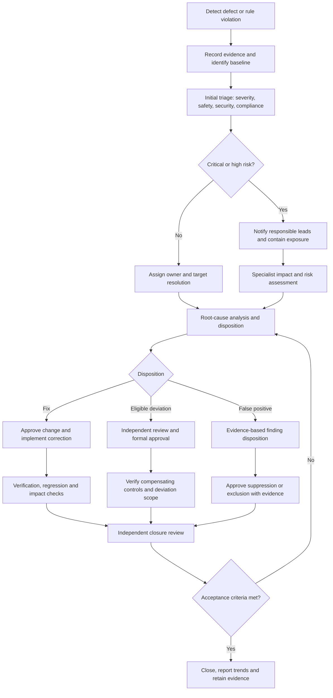
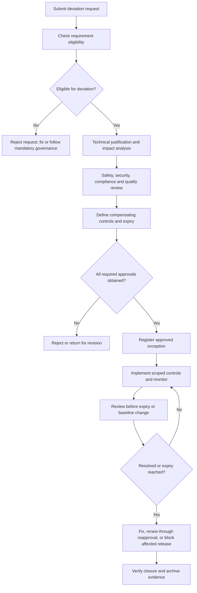

## 1. Purpose and objectives

This procedure establishes a standardized, risk-based mechanism for identifying, classifying, containing, escalating, approving, tracking, and closing code quality defects and deviations throughout the automotive electronic software development lifecycle.

It applies to embedded software, ECU software, automotive middleware, operating-system integration, vehicle-domain controllers, smart cockpit software, cross-domain platforms, and in-vehicle AI software components.

The objectives are to:

1. Prevent unsafe, insecure, noncompliant, or insufficiently verified software from progressing to subsequent development gates or production release.
2. Ensure defects are classified and escalated according to technical severity, safety impact, cybersecurity impact, customer impact, and release risk.
3. Establish controlled deviation approval without weakening mandatory safety, security, legal, regulatory, or customer requirements.
4. Ensure each accepted deviation has documented rationale, risk assessment, compensating controls, ownership, expiration conditions, and closure criteria.
5. Maintain traceability among code changes, static-analysis findings, peer reviews, verification evidence, requirements, risk analyses, and release decisions.
6. Drive systemic improvement through root-cause analysis, corrective and preventive actions (CAPA), and defect trend analysis.

## 2. Scope and governing principles

### 2.1 Applicable activities

This procedure covers:

- Code quality defect management: coding-rule violations, static-analysis findings, code-review issues, runtime defects, test failures, robustness weaknesses, and maintainability problems.
- Safety and cybersecurity escalation: assessment of potential impacts on functional safety, secure coding, attack surfaces, diagnostic services, memory integrity, and system behavior.
- Deviation and waiver control: formal authorization for a specifically identified exception to an applicable internal coding rule, tool rule, process requirement, or approved project criterion, where the requirement is eligible for deviation.
- Release and lifecycle control: defect disposition, corrective changes, regression testing, release exceptions, and evidence required for software integration and delivery.

### 2.2 Mandatory principles

- **Safety first:** A suspected safety-related defect is escalated immediately, regardless of its initial numerical priority.
- **No silent acceptance:** A known defect must have a recorded disposition. Suppression or closure without evidence is prohibited.
- **No self-approval:** The person introducing a deviation must not be its sole approver.
- **Risk-based decisions:** Severity, likelihood, exposure, detectability, and affected vehicle functions inform escalation. A numerical score must not override a safety or security veto.
- **Time-bounded exceptions:** Every deviation must have an expiration date or objectively defined expiration event.
- **Evidence-based closure:** “Closed” requires verifiable evidence and approval according to the applicable risk class.
- **Traceability:** Defects and deviations remain linked to the relevant code revision, software baseline, tool output, requirements, tests, and release record.

## 3. Standards and process alignment

The procedure should be integrated into the organization's quality management system rather than operated as an independent defect-tracking activity.

| Reference | Application |
|---|---|
| ISO 26262-6 | Software-level development, implementation, unit verification, integration, and testing for safety-related automotive software. |
| Automotive SPICE SUP.9 | Problem identification, classification, analysis, escalation, resolution, closure, and trend reporting. |
| Automotive SPICE SUP.10 | Change request analysis, approval, implementation tracking, and traceability to affected work products. |
| ISO/SAE 21434 | Cybersecurity engineering and risk management where software defects affect automotive cybersecurity. |
| ISO 9001 / IATF 16949 | Applicable quality management, nonconformity control, corrective action, and customer-specific requirements. |
| MISRA C/C++, CERT, project coding standards | Coding-rule baselines, static-analysis findings, rule justifications, and controlled exceptions. |
| ISO/IEC 5230 or project OSS policy | Open-source license compliance where third-party or open-source code is involved. |

Verify applicable editions, contractual obligations, customer-specific requirements, and regulatory requirements before adopting this procedure. This table is an alignment guide, not a declaration of conformity or certification.

## 4. Terminology and decision boundaries

- **Defect:** An observed or suspected failure to satisfy a specified requirement, coding rule, design constraint, quality criterion, or expected behavior.
- **Deviation:** A formally reviewed request to depart from a defined requirement or process criterion within the scope of authority permitted by the governing requirement.
- **Waiver:** An authorized, bounded exception to a specific requirement, typically for a defined product, baseline, component, or time period. A waiver does not establish that the requirement has been satisfied.
- **False positive:** A tool finding demonstrated to be inapplicable to the analyzed code or configuration, supported by reproducible technical evidence.
- **Containment:** Immediate action to prevent an identified defect from causing further impact, spreading to other baselines, or entering a controlled release.
- **Corrective action:** Action that removes the cause of an identified defect or nonconformity.
- **Preventive/systemic action:** Action that reduces the likelihood of recurrence in other components, projects, tools, or processes.

### 4.1 Defect versus deviation

| Situation | Required handling |
|---|---|
| Genuine coding defect that violates a requirement | Fix the defect and verify the correction. |
| Coding-rule finding that is demonstrably inapplicable | Document evidence and approve the finding disposition under the tool governance process. |
| Valid code that violates an eligible internal coding rule | Fix it or request a formal, rule-specific deviation. |
| Failure to meet a mandatory safety requirement | No ordinary waiver; contain, resolve, and complete the applicable safety assessment and approval process. |
| Security weakness with credible exploitation potential | Use the security incident/vulnerability workflow, risk assessment, and containment as applicable; a coding waiver alone is insufficient. |
| Deadline pressure without technical evidence | Not a valid basis for approving a deviation. |

A defect must not be relabeled as a false positive or deviation merely to improve quality metrics or meet a release deadline.

## 5. Defect severity and escalation classification

The following classification is a recommended organizational baseline. Projects should map it to their existing severity, safety, cybersecurity, and customer-incident schemes.

| Severity | Classification | Examples / triggers | Proposed response target |
|---|---|---|---|
| **S0** | Critical | Potential catastrophic or life-threatening safety consequence; credible compromise of a safety-critical function; severe exploitable vulnerability; uncontrolled production or field exposure with major impact. | Containment immediately. Do not wait for full root-cause analysis. |
| **S1** | High | Significant functional malfunction, potential violation of a safety requirement, substantial cybersecurity exposure, major reliability failure, or critical release-gate failure. | Acknowledge within 1 hour; containment decision within 4 hours. |
| **S2** | Medium | Localized functional or robustness defect, significant maintainability issue, noncritical coding-rule violation, or repeated test failure without established major safety/security impact. | Triage within 1 business day; resolution plan within 2 business days. |
| **S3** | Low | Minor maintainability, documentation, naming, or low-impact quality issue with no identified functional, safety, security, or compliance impact. | Triage within 3 business days; resolve according to the approved sprint or release plan. |

These response targets are proposed internal service levels, not prescribed timelines from ISO 26262 or Automotive SPICE. S0/S1 response must be faster when required by the incident response plan, customer contract, or applicable law.

### 5.1 Severity assignment rules

Severity is based on the credible consequence of the defect, not solely on how easy it is to reproduce.

Assess at least:

- Safety impact and affected safety goals or safety requirements.
- Cybersecurity impact, exploitability, exposure, and affected assets.
- Functional impact and operational degradation.
- Vehicle fleet, ECU variants, software baselines, and customer exposure.
- Detection likelihood, diagnostic coverage, and availability of safe fallback behavior.
- Release status: development, integration, validation, production, or field deployment.
- Reproducibility, scope of affected code, and potential common-cause defects.

Where severity is uncertain, assign the higher plausible class provisionally until qualified assessment establishes otherwise. Functional safety and cybersecurity specialists must independently assess issues in their respective domains.

## 6. Defect escalation workflow

### 6.1 Procedure steps and mandatory outputs

| Step | Activity | Required output |
|---|---|---|
| 1. Detect | Capture findings from static analysis, code review, unit tests, integration tests, fuzzing, security scans, or field reports. | Defect record and evidence |
| 2. Register | Assign a unique ID and link the affected repository, commit, branch, build, component, and software baseline. | Traceable defect record |
| 3. Triage | Assign provisional severity, category, ownership, affected variants, and safety/security flags. | Triage decision |
| 4. Escalate | Notify required stakeholders according to severity, exposure, and contractual obligations. | Notification and acknowledgment record |
| 5. Contain | Block merge or release, quarantine artifacts, disable affected functionality, or implement another authorized containment measure. | Containment plan and verification |
| 6. Analyze | Reproduce the issue, determine root cause, assess impact, and identify related defects. | Analysis and risk assessment |
| 7. Decide | Select correction, eligible deviation, demonstrated false positive, or another controlled disposition. | Approved disposition |
| 8. Implement | Apply the approved correction or authorized exception controls; link changes to the original defect. | Change request, patch, or deviation record |
| 9. Verify | Perform required unit, integration, regression, static-analysis, security, and safety verification. | Verification evidence |
| 10. Close | Confirm acceptance criteria, traceability, approvals, and residual-risk treatment. | Authorized closure |
| 11. Improve | Analyze recurring defects and implement systemic actions. | Trend report and CAPA records |

For S0/S1 defects, containment and stakeholder notification take priority over completing the full analysis. Emergency mitigation may follow the approved incident process, but must not bypass applicable safety, security, or release authorization requirements.

## 7. Roles, responsibilities, and approval authority

The project shall establish a RACI matrix covering defect handling, deviations, and release authorization. One person may perform multiple roles on a small project, but independent review and mandatory specialist approvals must be preserved.

**R = Responsible; A = Accountable; C = Consulted; I = Informed.**

| Activity | Developer | SW Lead | QA | Safety / Security | Release Manager / CCB |
|---|---|---|---|---|---|
| Register defect | R | A | C | I/C | I |
| Assign severity and owner | C | R | A/C | C | I |
| Contain critical defect | R | A | C | C/R | I |
| Perform root-cause analysis | R | A | C | C | I |
| Approve corrective change | R | A | C | C | I/C |
| Approve coding-rule deviation | C | C | R/C | C where relevant | A |
| Approve safety-related disposition | C | C | C | A/R through safety governance | C |
| Approve cybersecurity disposition | C | C | C | A/R through security governance | C |
| Authorize software release | I | C | C | C / required sign-off | A/R |
| Close defect | R | C | A | C / mandatory where applicable | I |

### 7.1 Approval rules

1. The software lead may assign work and approve routine technical dispositions within delegated authority.
2. QA verifies process compliance and evidence completeness; QA does not substitute for the technical authority responsible for safety or cybersecurity risk acceptance.
3. Functional safety and cybersecurity authorities approve decisions within their assigned governance scope.
4. The Change Control Board (CCB) or designated deviation authority approves exceptions to eligible organizational or project requirements.
5. The release authority cannot override a mandatory safety, security, legal, regulatory, or customer acceptance requirement without a valid, formally authorized process permitted by that requirement.
6. The person who implements a fix must not be the only person verifying and closing it.

## 8. Deviation management procedure

### 8.1 Deviation eligibility

Before a deviation is considered, determine whether the requirement is eligible for an exception.

**Potentially eligible:** An internal style preference, an approved project-specific coding convention, a tool rule demonstrated to be inapplicable in a defined context, or an approved design constraint with an explicitly permitted exception mechanism.

**Not eligible for ordinary deviation approval:** A mandatory legal or regulatory requirement; a safety requirement for which no permitted exception process exists; a security requirement whose relaxation would create an unacceptable risk; an unmet customer acceptance condition without authorized customer disposition; or a release criterion explicitly defined as non-waivable.

An exception must never be approved solely because the deadline is approaching, the fix is expensive, the finding count is too high, or the violation is inherited from a third-party component.

### 8.2 Deviation lifecycle

### 8.3 Mandatory deviation approval content

Every deviation request must include:

- Unique deviation ID and linked defect ID.
- Exact rule or requirement identifier, version, and original wording.
- Affected files, functions, components, variants, branches, and software baselines.
- Technical reason for the requested exception and why compliant alternatives are impractical.
- Impact analysis covering functionality, safety, cybersecurity, robustness, maintainability, testability, and downstream integration.
- Risk assessment, including residual risk and assumptions.
- Proposed compensating controls and evidence demonstrating their effectiveness.
- Required approvals, implementation owner, monitoring responsibility, and review date.
- Expiration date or objectively defined expiration event.
- Closure criteria, rollback strategy, and corrective action plan where applicable.

### 8.4 Approval levels

| Deviation category | Minimum approval |
|---|---|
| Low-risk internal style rule | Software lead + independent reviewer |
| Coding-rule violation with technical or verification implications | Software lead + coding-standard owner + QA |
| Rule affecting memory safety, concurrency, fault handling, or critical robustness | Software architect + relevant technical authority + QA; safety review when applicable |
| Safety-related rule or requirement | Functional safety authority through the approved safety lifecycle; no ordinary waiver of mandatory requirements |
| Cybersecurity-related rule or requirement | Cybersecurity authority through the security risk-management process |
| Customer-defined rule or acceptance criterion | Internal delegated authority plus customer approval where contractually required |
| Release-gate exception | Release authority and all applicable domain authorities; only if the gate is formally waivable |

These are baseline organizational controls. The project-specific authority matrix must identify named roles, approval limits, and any required customer or independent assessor involvement.

### 8.5 Expiration and renewal

A deviation must not remain valid indefinitely by default.

- Set the expiry at the next release milestone or within 90 days, whichever comes first, unless the approved policy defines another justified period.
- Reassess the deviation whenever the affected code, compiler, tool configuration, safety concept, threat assessment, or system architecture changes materially.
- Reopen the deviation if the compensating control fails or its assumptions cease to hold.
- Require fresh approval for renewal; renewal must not be automatic.
- On expiry, block affected release promotion until the deviation is corrected or validly reapproved under the applicable rules.

## 9. Code quality defect closure criteria

A defect may be closed only after the required criteria for its class have been satisfied.

- [ ] Root cause and affected scope are documented.
- [ ] Corrective change is linked to the defect and approved change record.
- [ ] Code review and applicable coding-rule checks are complete.
- [ ] Required unit, integration, and regression tests pass.
- [ ] Safety and cybersecurity impact assessments are updated where applicable.
- [ ] Static-analysis findings are resolved or validly dispositioned.
- [ ] Affected requirements, tests, variants, and baselines remain traceable.
- [ ] No new unacceptable regression or unresolved blocking finding remains.
- [ ] Required independent verification and closure approval are recorded.

For S0/S1 defects, closure must additionally confirm that required safety/security assessments, field containment decisions, customer notifications, and release approvals have been completed by the responsible authorities.

A defect may be marked **Resolved — pending verification** when the fix is implemented but verification is incomplete. It must not be marked **Closed** until all mandatory acceptance criteria are met.

## 10. Release-gate integration

The defect and deviation process must be embedded in the development pipeline.

| Gate | Required quality decision |
|---|---|
| Code commit | Automated checks execute; critical prohibited findings block integration. |
| Pull request / merge | Required reviews completed; no unresolved blocking defect or unapproved deviation. |
| Continuous integration | Build, unit tests, static analysis, and relevant security checks pass. |
| Software integration | Cross-component issues analyzed; integration regressions and interface defects dispositioned. |
| Verification completion | Required test coverage and verification evidence meet project criteria. |
| Release candidate | All mandatory quality gates passed; open defects and deviations reviewed against release policy. |
| Production release | Formal release authorization, configuration integrity, traceability, and required safety/security approvals confirmed. |
| Post-release monitoring | Field issues, vulnerabilities, regressions, and customer reports enter the same controlled lifecycle. |

### 10.1 Release-blocking conditions

Unless a formally approved requirement-specific mechanism explicitly permits otherwise, the following block release:

- Open S0 or S1 defects that may affect the proposed release.
- Unresolved safety or cybersecurity risks beyond the project's acceptance criteria.
- Failed mandatory tests or missing required verification evidence.
- Unapproved deviations or expired deviations affecting the release.
- Missing required customer approval or regulatory evidence.
- Uncontrolled code changes, unverified patches, or a mismatch between the tested and released baselines.
- Open defects that breach explicit project, contractual, or organizational release criteria.

An open S2 or S3 defect is not automatically release-blocking in every project. Its disposition must be consistent with the defined release criteria and documented residual-risk decision.

## 11. Standard templates and records

These templates can be implemented in Jira, Azure DevOps, Codebeamer, Polarion, or an equivalent lifecycle management system.

### 11.1 Template A — Code quality defect report

**Required for every registered defect or quality finding.**

| Field | Value |
|---|---|
| Defect ID | |
| Component / function | |
| Affected baseline / commit | |
| Detection source | Static analysis / Code review / Unit or integration test / Security scan / Field report / Other |
| Initial severity | S0 / S1 / S2 / S3 |
| Rule / requirement ID | |
| Description and reproduction steps | |
| Expected behavior | |
| Actual behavior | |
| Evidence / logs / tool output | |
| Safety impact | Confirmed / Suspected / Not identified / Pending |
| Cybersecurity impact | Confirmed / Suspected / Not identified / Pending |
| Affected variants and releases | |
| Initial containment | |
| Responsible owner | |
| Target resolution date | |
| Linked records | |

### 11.2 Template B — Deviation / waiver request

# Code Quality Deviation Request

**1. Identification**
- Deviation ID:
- Linked defect ID:
- Project / ECU / component:
- Requestor / date:
- Affected repository, file, function, commit, and baseline:

**2. Requirement being deviated from**
- Rule / requirement ID and version:
- Original requirement text:
- Requirement owner:
- Classification: Internal / Customer / Safety / Cybersecurity / Legal / Other
- Eligibility for deviation: Yes / No / Pending review

**3. Technical justification**
- Description of the deviation:
- Reason for requesting the exception:
- Compliant alternatives evaluated:
- Reason alternatives are unsuitable:

**4. Impact and risk assessment**
- Functional and robustness impact:
- Safety impact and assessment reference:
- Cybersecurity impact and assessment reference:
- Compliance and customer impact:
- Affected configurations and dependencies:
- Residual risk and acceptance rationale:

**5. Compensating controls**
- Technical controls:
- Verification and monitoring:
- Evidence of control effectiveness:
- Failure response and rollback plan:

**6. Scope and validity**
- Exact files / functions / variants / baselines covered:
- Exclusions:
- Approval date:
- Expiration date or event:
- Review trigger:
- Corrective action owner and target date:

**7. Required decisions**
- Software lead:
- Coding-standard owner:
- QA:
- Functional safety authority, if applicable:
- Cybersecurity authority, if applicable:
- Customer / contractual authority, if required:
- CCB / designated deviation authority:
- Decision: Approved / Rejected / Returned for revision

**8. Closure**
- Corrective change or final disposition:
- Verification evidence:
- Expiration and renewal status:
- Final closure approval and date:

### 11.3 Template C — Defect escalation notice

**Subject:** [S0/S1/S2] Code Quality Defect Escalation — [Defect ID]

- **Project / Component:** [Name]
- **Affected baseline:** [Release / branch / commit]
- **Defect summary:** [Concise description]
- **Severity and rationale:** [S0–S3; impact and evidence]
- **Safety impact:** [Confirmed / Suspected / Not identified / Pending assessment]
- **Cybersecurity impact:** [Confirmed / Suspected / Not identified / Pending assessment]
- **Exposure:** [Development / Integration / Release candidate / Production / Field]
- **Immediate containment:** [Action, owner, status, evidence]
- **Decision required:** [Block merge / Block release / Initiate incident response / Approve mitigation / Other]
- **Responsible owner:** [Name or role]
- **Next update:** [Date and time]
- **Linked records:** [Defect, change request, risk assessment, test evidence]

Please acknowledge this escalation and confirm the assigned owner and immediate actions in accordance with the project escalation procedure.

### 11.4 Template D — Defect closure report

# Code Quality Defect Closure Report

- Defect ID:
- Severity:
- Component / baseline:
- Original finding and root cause:
- Corrective action:
- Related change request and commit:
- Code review evidence:
- Static-analysis results:
- Unit / integration / regression test results:
- Safety and cybersecurity reassessment:
- Related defects and variants checked:
- Residual risks and approved dispositions:
- Deviation reference, if applicable:
- Closure acceptance criteria:
- Independent reviewer:
- QA acceptance:
- Domain authority approval, if required:
- Final status: Closed / Reopened / Rejected for closure
- Closure date:
- Lessons learned and systemic actions:

## 12. Practical example: MISRA C rule violation in ECU software

The following is an illustrative scenario, not a claim about a specific MISRA rule or actual automotive project.

**Scenario:** A static-analysis tool reports a coding-rule violation in a braking-related ECU software module. The development team initially considers a deviation because the software release deadline is approaching.

### Phase 1 — Detection and containment

- Register the finding with the rule ID, source location, tool version, configuration, and commit.
- Notify the software lead and QA; escalate to the functional safety team because the affected module is safety-related.
- Prevent promotion of the affected baseline until the initial impact assessment and required containment decision are complete.

### Phase 2 — Investigation

- Reproduce the finding and inspect the affected control flow and data paths.
- Determine whether the issue is a genuine defect, an inapplicable tool finding, or valid code that violates an eligible internal rule.
- Analyze possible effects on numerical behavior, memory integrity, timing, fault handling, and relevant safety requirements.

### Phase 3 — Disposition

**Preferred path: correct the code**

Implement a compliant correction, perform peer review, rerun static analysis, and execute the required unit and regression tests. Update the affected traceability and verification evidence.

**Alternative path: eligible deviation only**

If the rule permits deviation, document the precise technical justification, risk assessment, compensating controls, verification evidence, scope, and expiry. Obtain the approvals required by the rule owner and project governance. Safety approval must follow the applicable safety lifecycle.

### Phase 4 — Release decision

- QA confirms the defect record and required evidence are complete.
- The functional safety authority confirms the necessary safety assessment and evidence.
- The release authority confirms all release criteria are satisfied.
- The defect is closed only after required verification and independent acceptance. Any unresolved mandatory blocker prevents release.

**Key lesson:** A deadline is a scheduling constraint, not evidence that a code quality deviation is technically acceptable.

## 13. Management metrics and review cadence

The quality organization should monitor both defect-resolution performance and the effectiveness of preventive controls.

| Metric | Definition / recommended use |
|---|---|
| Critical/high defect aging | Number and age of open S0/S1 defects; review daily while active. |
| Escalation response compliance | Percentage of escalations acknowledged within the defined target. |
| Mean time to contain | Average elapsed time from detection to verified containment. |
| Mean time to resolve | Average elapsed time from registration to verified resolution; segment by severity. |
| Reopen rate | Reopened defects divided by defects closed during the reporting period. |
| Repeat-defect rate | Defects recurring from the same root cause or failed preventive action. |
| Deviation count and aging | Active deviations by rule, risk, owner, baseline, and expiration. |
| Expired deviation count | Number of active exceptions past expiry; target zero. |
| Release escape rate | Defects first detected after release, normalized where appropriate. |
| Static-analysis compliance | Applicable findings resolved or validly dispositioned against the approved rule baseline. |
| Root-cause action effectiveness | Percentage of corrective actions verified as effective after implementation. |

### 13.1 Recommended governance cadence

- **Daily:** S0/S1 defect review, containment, owner assignment, and escalation status.
- **Weekly:** Open S2/S3 aging, deviation reviews, blocked merges/releases, and overdue actions.
- **At each release gate:** Formal review of open defects, active deviations, residual risks, and mandatory evidence.
- **Monthly:** Trend analysis, repeat defects, tool-rule quality, systemic corrective actions, and management reporting.
- **At project milestones:** Review process effectiveness and lessons learned across components and variants.

Targets should be baselined using actual project data. For mandatory blockers, expired deviations, and unapproved exceptions, the control objective is zero unauthorized cases.

## 14. Implementation checklist

- [ ] Approve the defect severity and escalation matrix.
- [ ] Publish the deviation eligibility policy and non-waivable requirement list.
- [ ] Define named escalation contacts and after-hours coverage.
- [ ] Configure defect, deviation, change request, and approval workflows.
- [ ] Integrate static analysis, coding-rule checks, and test results with issue tracking.
- [ ] Enforce branch protection and release-gate blocking rules.
- [ ] Define required safety and cybersecurity assessment triggers.
- [ ] Establish independent verification and closure authority.
- [ ] Set deviation expiry notifications and release-baseline checks.
- [ ] Launch defect aging, deviation, and release escape dashboards.
- [ ] Train developers, reviewers, QA, safety, security, and release personnel.
- [ ] Audit process compliance and effectiveness after initial deployment.

## 15. Reference sources

The procedure is designed to support, not replace, the organization's controlled standards and engineering processes.

- **ISO 26262-6:2018** — Software-level product development. Official ISO page: https://www.iso.org/standard/68388.html
- **Automotive SPICE SUP.9** — Problem Resolution Management. UL Solutions guidance: https://www.ul.com/sis/resources/process-sup-9
- **Automotive SPICE SUP.10** — Change Request Management. UL Solutions guidance: https://www.ul.com/sis/resources/process-sup-10
- **ISO/SAE 21434:2021** — Road vehicle cybersecurity engineering. Official ISO page: https://www.iso.org/standard/70918.html

## 16. Document governance

Before release as a controlled procedure, the organization should:

1. Assign a document owner and approving authority.
2. Add the document ID, revision history, effective date, and approval signatures.
3. Tailor severity thresholds and response targets to customer, legal, and organizational obligations.
4. Identify non-waivable requirements and formally authorized exception mechanisms.
5. Define named roles, delegated authority, escalation contacts, and after-hours coverage.
6. Integrate required records and gates with the organization's lifecycle and configuration management tools.
7. Review the procedure periodically and after major safety, cybersecurity, customer, or process changes.

**Governance recommendation:** Approve this document as a controlled organizational procedure and tailor the response targets, non-waivable rules, approval matrix, and release criteria to each product's safety classification, cybersecurity risks, customer obligations, and development lifecycle.
